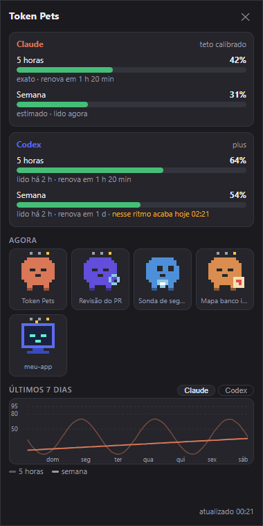
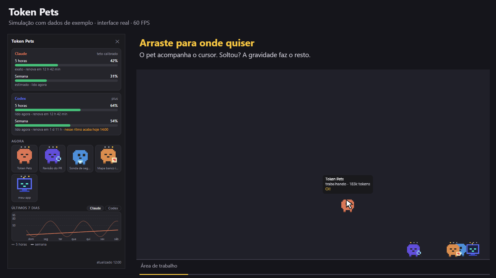

<p align="center">
  
</p>

<h1 align="center">Token Pets</h1>

<p align="center">
  Seus agentes de IA fazendo companhia na área de trabalho.<br />
  Acompanhe os limites do Claude e do Codex com mascotes em pixel art.
</p>

<p align="center">
  <a href="https://github.com/EduardooPV/token-pets/releases/latest"></a>
  
  
  
  <a href="./LICENSE"></a>
</p>

<p align="center">
  <a href="#baixar">Baixar</a> ·
  <a href="#prévia">Prévia</a> ·
  <a href="#como-usar">Como usar</a> ·
  <a href="#privacidade">Privacidade</a> ·
  <a href="#desenvolvimento">Desenvolvimento</a>
</p>

## Baixar

**[Baixe a última versão para Windows →](https://github.com/EduardooPV/token-pets/releases/latest)**

| Arquivo | Para que serve |
| --- | --- |
| `Token-Pets-<versão>-win.exe` | Instalador com assistente, atalho no Menu Iniciar e na área de trabalho. |
| `Token-Pets-<versão>-win.zip` | Versão portátil: extraia tudo e abra `Token Pets.exe`. |

1. Baixe e execute o instalador `.exe`.
2. Conclua a instalação para o seu usuário, sem precisar de administrador.
3. Abra **Token Pets** pelo Menu Iniciar ou pelo atalho da área de trabalho. O painel aparece na abertura manual.

Requisitos: **Windows 10 ou 11, 64 bits**. Para mostrar uso e sessões, o app lê os arquivos locais do
**Claude Code** e do **Codex**. Sem essas ferramentas, os mascotes aparecem dormindo e o painel fica sem dados.

### Instalou, mas não abre?

O executável normalmente fica em `%LOCALAPPDATA%\Programs\token-pets\Token Pets.exe`.
Enquanto estiver aberto, o app também aparece na **bandeja, perto do relógio**, às vezes dentro do `^`.

**É possível instalar e usar o Token Pets sem certificado**, assim como outros apps Windows. O projeto
publica versões sem assinatura quando não há certificado configurado. O comportamento depende da proteção
que o Windows está aplicando:

| Aviso | Como prosseguir |
| --- | --- |
| **SmartScreen:** “O Windows protegeu o computador”, com **Mais informações** | Se você confia na origem, clique em **Mais informações → Executar assim mesmo** e conclua a instalação. |
| **Smart App Control:** “Controle inteligente de aplicativos bloqueou…” | Não há botão para permitir só esse app. O bloqueio também pode atingir o executável depois da instalação. |
| Política de uma empresa ou organização | Solicite a liberação ao administrador; a configuração pode ser gerenciada. |

Para executar **este binário sem assinatura quando ele foi bloqueado pelo Smart App Control**, a alternativa
manual documentada pela Microsoft é desativar esse recurso em **Segurança do Windows → Controle de
aplicativos e do navegador → Configurações do Controle inteligente de aplicativos → Desativado** e tentar
abrir o Token Pets novamente. **A mudança reduz a proteção para todos os aplicativos, não só o Token Pets.**
Leia o aviso da sua versão do Windows antes de alterar; versões recentes permitem reativar sem reinstalação,
enquanto versões anteriores têm restrições. O Microsoft Defender é um recurso separado.

Se quiser manter o Smart App Control ativo, uma versão assinada com certificado confiável é a alternativa
de distribuição mais previsível. O serviço de reputação do Windows também pode reconhecer apps sem
assinatura, mas isso não é garantido para cada novo build. Reinstalar, usar o ZIP ou executar como
administrador não cria uma exceção no Smart App Control.

**Tauri e Electron estão sujeitos às mesmas proteções do Windows.** Trocar a tecnologia não dispensa nem
impõe, por si só, um certificado. A chave de assinatura do atualizador do Tauri, como a usada no Lexo,
também não substitui uma assinatura Authenticode reconhecida pelo Windows.

Referências: [FAQ do Smart App Control — Microsoft](https://support.microsoft.com/en-us/windows/security/threat-malware-protection/smart-app-control-frequently-asked-questions),
[assinatura no Tauri](https://v2.tauri.app/distribute/sign/windows/) e
[distribuição com Electron](https://www.electronjs.org/docs/latest/tutorial/code-signing).

## Prévia

Capturas da interface real no Electron, com **dados de exemplo**. A demonstração tem **36 segundos, a
60 FPS**, com cursor e marcação dos cliques. Mostra clique e balão de informações, arraste, queda,
arremesso, duplo clique, funções dos agentes, cansaço, comemoração e descanso.

A simulação captura cada quadro do app com um relógio controlado para evitar quadros congelados na
gravação. Não contém conversas ou dados de uso reais e não é um benchmark do desktop.

<p align="center">
  
</p>


**[▶ Assistir à demonstração completa — 36 s / 60 FPS](./docs/media/demonstracao.mp4)**

<a href="./docs/media/demonstracao.mp4"></a>

| Tempo | Demonstração |
| --- | --- |
| 0–4 s | Agentes ativos, clique, balão de informações e pulinho. |
| 4–12 s | Arrastar, soltar, cair, arremessar e quicar. |
| 12–20 s | Duplo clique para o painel e identidade de cada agente. |
| 20–28 s | Pets cansados, exaustos e comemorando a renovação. |
| 28–36 s | Mascotes dormindo e clique fora dos pets. |

## Como usar

Clique no ícone da bandeja para abrir ou fechar o painel. O menu do botão direito permite mostrar os pets,
ativar sons, consultar o percentual exato do Claude, iniciar com o Windows e sair.
Ao iniciar automaticamente com o Windows, o painel fica recolhido na bandeja.

| Gesto | O que acontece |
| --- | --- |
| Arrastar um pet | Ele acompanha o cursor; ao soltar, cai e pousa na barra de tarefas. |
| Arrastar e soltar com impulso | Arremessa o pet, com gravidade e quique. |
| Clicar | Mostra nome, estado, tokens e uma fala do personagem. |
| Clicar duas vezes | Abre o painel de uso. |
| Clicar fora dos pets | O clique passa para o aplicativo que está por baixo. |

- **Um pet por sessão ou subagente**, até oito na tela; os demais ficam agrupados em `+N`.
- **Nomes reconhecíveis:** título ou projeto da sessão, apelido e função do agente. Quando faltam
  metadados, um nome estável como “Claude · Luna” substitui o ID.
- **Cores e acessórios próprios:** lupa para revisão, escudo para segurança, mapa para exploração e
  caneta para escrita. Agentes do Claude usam o `color` declarado no frontmatter quando disponível.
- **Estados visíveis:** trabalhando, esperando, cansado (80%), exausto (95%), dormindo e comemorando
  a renovação do limite. Movimento e interação usam até 60 FPS; em repouso a cadência cai para poupar recursos.
- **Limites de cinco horas e semanais**, histórico de sete dias, projeção de esgotamento e alertas.
  O painel identifica leituras exatas, dados dos logs e estimativas.

Para fechar o painel, pressione **Esc**. Para encerrar o app inteiro, escolha **Sair** na bandeja.
Para desinstalar, use **Configurações → Aplicativos → Token Pets**; as preferências e o histórico ficam
em `%APPDATA%\token-pets` e podem ser apagados separadamente.

## Privacidade

O app processa os logs localmente para obter contagens de tokens, modelo, título, pasta e metadados dos
agentes. O conteúdo das conversas não é persistido nem enviado pelo Token Pets. Sem telemetria ou analytics.

| Fonte local | Uso |
| --- | --- |
| `~/.claude/projects/**/*.jsonl` e metadados dos subagentes | Estimativa do uso do Claude, títulos e sessões ativas. |
| `~/.codex/sessions/**/*.jsonl` | Tokens, limites registrados pelo Codex e identificação das sessões. |
| `~/.claude/agents/*.md` e `.claude/agents/*.md` dos projetos | Nome e cor declarados no frontmatter. |
| `~/.claude/.credentials.json` | Token OAuth, somente para a consulta opcional de uso exato. |

A opção **% exato do Claude** vem ligada. Ela faz uma consulta a cada cinco minutos a
`https://api.anthropic.com/api/oauth/usage`. O token é usado nessa chamada e não é renovado, gravado ou
registrado em log pelo app. Desative a opção na bandeja para usar somente a estimativa local.
O endpoint não é documentado; em caso de falha, o painel informa a indisponibilidade e usa a estimativa.

O histórico de uso fica por até 30 dias em um SQLite em `%APPDATA%\token-pets`, junto das preferências.
As páginas do Electron usam isolamento de contexto e sandbox, sem acesso direto ao Node.js; navegação
externa, novas janelas e permissões são bloqueadas.

<details>
<summary>Conferir a integridade do download</summary>

O GitHub Actions publica checksums SHA-256 e atestados de procedência:

```powershell
(Get-FileHash .\Token-Pets-<versão>-win.exe -Algorithm SHA256).Hash.ToLower()
# Compare o resultado com SHA256SUMS.txt no mesmo release.

gh attestation verify .\Token-Pets-<versão>-win.exe --repo EduardooPV/token-pets
```

Essas verificações comprovam integridade e origem do build; não substituem a assinatura digital do Windows.

</details>

## Desenvolvimento

Requisitos: **Node.js 24** e **pnpm 11**. O app e o instalador são destinados ao Windows.

```bash
git clone https://github.com/EduardooPV/token-pets.git
cd token-pets
pnpm install --frozen-lockfile
pnpm app
```

| Comando | Resultado |
| --- | --- |
| `pnpm dev` | Interface com exemplos em `http://localhost:1420/popup.html` e `/pet.html`. |
| `pnpm app` | Compila e abre o app completo com dados locais. |
| `pnpm typecheck` | Verificação de tipos. |
| `pnpm test` | Testes de coletores, limites, sessões, nomes, animação e física. |
| `pnpm test:app` | Compila e testa as interfaces no Electron, com capturas, vídeo WebM e relatório em `release/qa/`. |
| `pnpm demo:video` | Gera a demonstração de 36 s / 60 FPS em `docs/media/demonstracao.mp4`, usando FFmpeg instalado no PATH. |
| `pnpm dist` | Gera instalador NSIS e ZIP em `release/`. |

O teste visual usa fixtures e um perfil separado, sem alterar as preferências do app instalado. Verifica
arraste, duplo clique, liberação do mouse fora dos pets e erros da interface. Execute em uma sessão gráfica
do Windows. Para medir recursos: `pwsh scripts/measure.ps1 -Minutes 10 -Label so-bandeja`.

```text
electron/       Bandeja, janelas, ciclo de vida e IPC
src/core/      Coletores do Claude/Codex, sessões, histórico e alertas
src/engine/    Sprites, renderização, animação, física e personalidade
src/popup/     Painel de uso e histórico
src/pet/       Pets flutuantes e interação com o ponteiro
scripts/       Ícone, teste visual e medição de recursos
```

### Releases automáticos

Pushes na `main`, exceto alterações só de documentação, executam o
[`release.yml`](./.github/workflows/release.yml): tipos, testes, build, instalador, ZIP, checksums e
atestado de procedência. A versão usa `MAJOR.MINOR` do `package.json` e o número da execução como patch.
Pull requests executam o [`ci.yml`](./.github/workflows/ci.yml).

Para assinar o Windows, configure os secrets **`WIN_CSC_LINK`** (certificado PFX em base64) e
**`WIN_CSC_KEY_PASSWORD`** (senha). Use um certificado de assinatura de código emitido por provedor
confiável pelo Windows. Com o certificado configurado, o pipeline exige assinatura e valida tanto o
executável instalado quanto o instalador antes de publicar. Sem ele, emite um aviso e produz um release
sem assinatura. [Referência do electron-builder](https://www.electron.build/v26/docs/features/code-signing/).

## Licença

[MIT](./LICENSE) · [Baixar a última versão](https://github.com/EduardooPV/token-pets/releases/latest)
